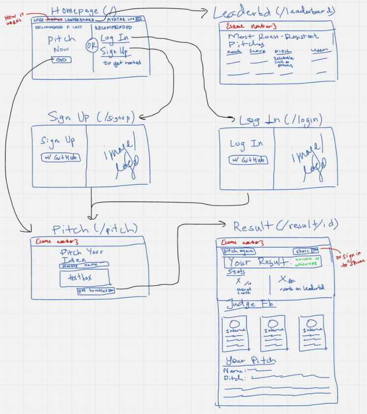

# 11/8/2026 - Upd 1

My first steps in building Unicorndt were twofold: 1. write a product spec, listing what functionalities and stakeholders/types of users would be interacting with the app, and 2. lay out a sitemap/information architecture.

## Product Spec

Stakeholders:

- primarily just the end user

Functionalities:

- users can create accounts/login via github
- users (does not have to be logged in) can input a startup idea via text box
  - there will be the following outputs:
    - from each of three judge personas:
      1. roast/feedback
      2. score out of 10
    - total score out of 30
    - verdict label (unicorn or unicorndt)
    - if logged in, leaderboard result
    - if logged in, share link to roast; otherwise, a prompt to 'sign in to claim your spot' or similar

## Sitemap



## Components

Based on our product spec and sitemap, we mapped out the following component pages for our frontend:

- `App`
- `HomePage`
- `LeaderboardPage`
- `SignUpPage`
- `SignInPage`
- `ResultPage`
- `PitchPage`

and the individual components

- `JudgeCard` - one VC's avatar, name, roast and score
- `Navbar` at the top

# 11/8/2026 - Upd 2

To simplify the architecture of our app, at least for its first version, we made the following changes.

## Product Spec Changes

Only place that changed is that the shareable results link is now on backlog.

## Sitemap Changes

- Drop `SignUp` and `SignIn` pages and replace with a single `sign in with github` button.
- Merge `Pitch` and `Result` pages into `HomePage`.
- Since shareable results page is on backlog, the results appear on the homepage and there is no need for changing url.

# 11/8/2026 - Upd 3

After adding `types.ts`, we moved to a new branch `ui` which will build out the frontend. In order to properly see how the frontend would display, we made a `mockData.ts` file which the frontend will temporarily reference.

Having wired the mock backend, we then moved onto implementing the components (for each page) and widgets (for the smaller things like buttons or the navbar). By the end of the day, `JudgeCard.tsx` and `NavBar.tsx` was created.

# 11/9/2026 - Upd 1

Our initial stack was `React` + `TailwindCSS` + `FastAPI`. However the UI was getting tiring to implement, so we added in the components library `ShadCN` to make the process more streamlined.

When adding ShadCN, we had to make the following changes:

- In `tsconfig.json`, add to main block:
  - ```// for shadCN library
    "compilerOptions": {
      "paths": {
        "@/*": ["./src/*"]
      }
    }
    ```
- In `tsconfig.app.json`, add to `"CompilerOptions"`:
  - ```// for shadCN library
    "paths": {
      "@/*": ["./src/*"]
    }
    ```
- In `vite.config.ts`, add
  - `import path from "path";` at the top and
  - ```resolve: {
      alias: {
        // for shadCN components lib
        "@": path.resolve(__dirname, "./src"),
      },
    },
    ```
    in `defineConfig`.
