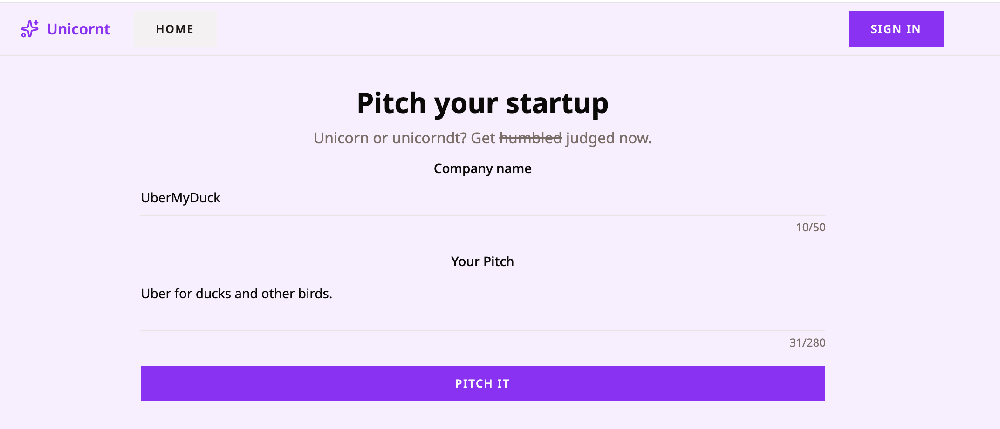
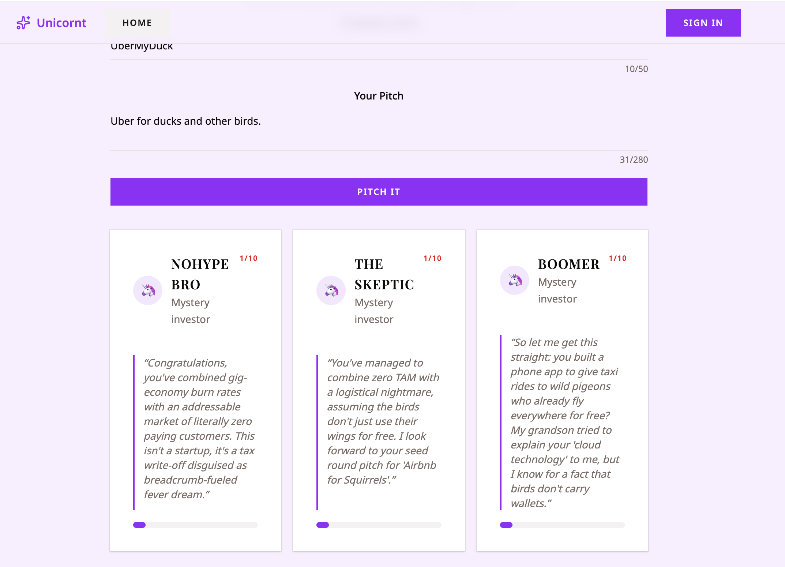
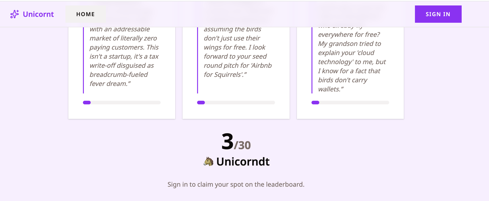
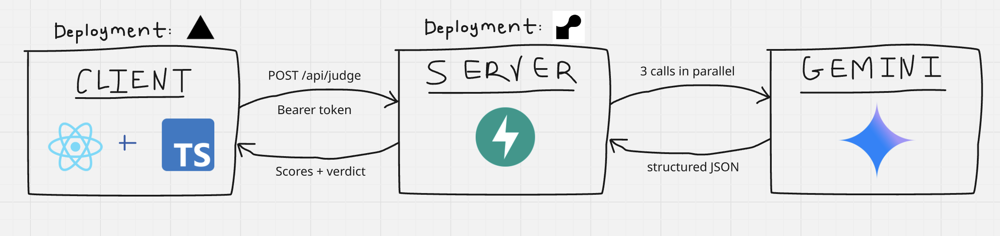

# 🦄 Unicornt

Get your startup idea judged, ranked and critiqued by a panel of virtual VCs who have 0% optimism.

**Live Demo:** https://unicornt.vercel.app 

1. Type a company name and a one tweet-length pitch. 

2. Three judges with varying personalities roast in parallel and score your pitch out of 10. 

3. If your total score out of 30 is >= 24, congrats: you're a ✨unicorn✨! Otherwise, you're a unicornt.

Sign up to get ranked on the leaderboard and share your results with friends (both features coming soon).

## Your Judge Panel

| Judge    | Persona |
| -------- | ------- |
| NoHype Bro  | Allergic to buzzwords, aggressively pessimistic, ignores anything good about your idea    |
| The Skeptic | Brutally honest; goes after weak business models, competition and wishful assumptions |
| Boomer    | Doesn't understand modern tech, but has sharp common sense about whether anyone would pay    |

## How It Works

For full build documentation, see [DEVLOG.md](https://github.com/codexistent/unicornt/blob/main/DEVLOG.md).

### Architecture Overview

1. React app sends pitch to FastAPI backend
2. Backend fires all three judges at AI server in one call, each with its own persona prompt
3. Each judge returns structured JSON, which the backend validates, clamps 1-10, totals, and returns in a verdict to frontend

### Design Considerations

- A single call to Gemini for all three judges. Thinking is turned off and token output is capped
    - Benefits:
        - faster judging
    - Tradeoffs:
        - feedback nuance is capped, although short punchy roasts don't necessarily need reasoning
- Gemini output is constrained to a Pydantic schema
    - Benefits: 
        - no string parsing
        - errors aren't returned in weird format
- One API contract on both sides (frontend TS and backend python/JSON) by using Pydantic's `to_camel` function
    - Benefits: 
        - field name and type bugs caught at compile time, not run time
    - Tradeoffs:
        - coupling between client and server types

### Stack

- **Frontend:** React, TS, Vite, TailwindCSS, ShadCN (Base UI); deployed on Vercel
- **Backend:** Python, FastAPI, Pydantic; deployed on Render
- **AI Provider:** Gemini (`gemini-3.6-flash`) via `google-genai` SDK
- **Auth:** Supabase w/ GitHub login

## About + Contact

Built by @codexistent just for fun. Please send feedback to codexistent@gmail.com.